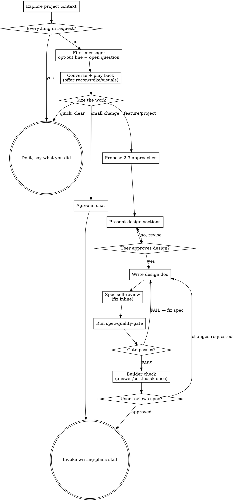

# Brainstorming Ideas Into Designs

You are very good at building. You build what you believe your human partner wants, and that belief is usually thinner than it feels. This skill finds out what they actually want, and why, before anything gets built — then turns it into a design/spec.

People often haven't finished working out what they want. Good questions help them think it through. When you understand the why, you make the hundred decisions they never mention the way they would have made them.

Start by understanding the current project context, then draw out intent through conversation, playing each part back as you understand it. Once you understand what you're building, size the work, write it down, and get user approval.

## First: What Do You Actually Know?

Before you reply, ask: what do I know about what they want, and why?

- **Everything that matters is in the request** ("make the icon cornflower blue"). This is a quick, clear task. Do it and say what you did — no spec, no gate.
- **Something non-trivial is missing.** Start the conversation (below).

## Your First Message

Two things, in this order, and nothing else:

1. One line saying that if they'd rather skip the questions and have you just start, they can say so. If they do, the *conversation* is done: state any significant how-it-gets-made choice (platform, language, medium) in one plain line, then proceed through the harness gates below (Business Context and spec still apply to feature work — they are harness policy, not questions).
2. One open question that gets them describing, anchored in a real moment or concrete picture: "What's the moment you find yourself wishing this existed?" / "Tell me about the people who'll use it."

## The Conversation

Each message ends with one question — a single sentence, no list of example answers hanging off it. Plain language, pitched slightly above where they are; match their vocabulary, never use process jargon. Lead with what matters; offer the rest.

- **Get them describing.** Open questions first — their own words carry intent your options can't. Offer a short menu (or `AskUserQuestion`) only when they're stuck. When they say "just guess" or "what do you think?", propose something concrete. A guess they can correct ("I'm guessing this is because X keeps biting you?") often beats a question.
- **How it gets made.** Find out early which choices about medium and tools (platform, language, libraries; medium for non-software) they want to own, which they hand to you, and what they already have. Strong views → talk it through. Handing over → pick sensible defaults and say them out loud. With existing work, build on what it already uses. Any choice you make goes in the spec as *your call*, never as something they agreed to. (Upstream added this after a session designed an iOS app, never asked about platform, and built a web app.)
- **Ground to cover** (territory, not a script — never read these out as questions): what kind of thing this is and what makes it special; why now and what success looks like to them; goals, non-goals, anti-goals (what would make it a failure even if it technically works); prior art they loved or hated; current state and what they've tried; the details they care about.
- **Questions that work** anchor in specifics: "Walk me through the last time…", "If it could only do one of these well, which?", "What would make you wince if I got it wrong?"
- **Offer recon.** Once you have some grounding and looking would help, offer to look — their codebase/project, their files and data, or the web. Say what you'd look for; they decide.
- **Think wide privately.** Before proposing anything, generate several ideas and drop the weak ones, including any that fight what they told you about *why*. Show the comparison only when it helps them decide.
- **Show, don't tell.** Offer the Visual Companion (below) whenever seeing would help more than reading.
- **Spike to feel things out.** A quick throwaway build is often the cheapest way to learn what they want or whether something works. Offer one when it would help. When they just want to spike, get out of the way: spikes get no/minimal tests, aren't bulletproof, and skip plan/implementation/review. Bring what it taught you back into the conversation. Keeping spike output is a new request that returns through the gates.

## Play It Back

As soon as you understand one part well enough to describe it (what it's for and who it serves, how one piece behaves), describe that part back in ~200-300 words, then return to questions about the next part. Playback and questions alternate; the last chunk covers what's left. Mark anything you're guessing as *your guess*; only what they said goes in as theirs. End each chunk by asking what's wrong or missing.

If a chunk describes something they'll look at (page, screen, schedule, printout) and they haven't seen the Visual Companion offer yet, send the offer instead (its own message) and hold the chunk. Once they've accepted, put a mockup next to the description.

## Size the Work

Once you understand what they want, pick a size and say it in plain words. They can override it; if it grows mid-task, stop, say so, and step up a size. If it is really several independent projects, say so, agree an order, and brainstorm them one at a time.

| Size | Full description | Then |
|------|------------------|------|
| Quick, clear task | the request itself | do it |
| Small change (bug fix, config, isolated utility — no business-context doc needed) | agreed in chat | `writing-plans` directly |
| Feature / project | REQ-format spec (Requirement Format below), through the gates | `high-level-design` or `writing-plans` |

## References — What a Great Spec Looks Like

These are the north star. Every spec written here should aspire to this bar.

**SQLite** — [requirements.html](https://sqlite.org/requirements.html)
Every requirement has a test ID. Test suite is 8× larger than the implementation. Richard Hipp's rule: if it's not tested, it doesn't exist. Every statement is immediately testable.

**RFC 8446 (TLS 1.3)** — IETF RFC format
Every state, every transition, every error condition named. Implementable from the doc alone. The MUST/SHOULD/MAY taxonomy forces every statement to be universal truth or verifiable behavior.

**seL4 microkernel** — NICTA/Data61
Spec written in Isabelle/HOL. Mathematically proven correct. If the proof compiles, the code is correct by construction. Ultimate form of the contract idea.

**WebAssembly specification** — W3C
Every instruction has formal reduction rules. No ambiguity possible. Multiple independent implementations converged on identical behavior from the spec alone.

**DO-178C** — aviation flight software standard
Every requirement traced to a test, every test traced to a requirement. No orphans. Traceability matrix is a mandatory deliverable.

<HARD-GATE>
Do NOT invoke any implementation skill, write any code, scaffold any project, install dependencies, or take any implementation action until the user has approved the full description: in chat for a small change, the spec document for a feature/project. Reading and exploring are fine.

Exceptions: a quick, clear task (the request already contains everything that matters), and a spike the user said yes to (stays labeled throwaway; keeping its output is a new request through this gate).
</HARD-GATE>

## Anti-Pattern: "This Is Too Simple To Need A Design"

"Simple" features are where unexamined assumptions cause the most wasted work. Sizing is a judgment made *after* you understand what they want and stated out loud — not a shortcut taken before asking. Approval covers what you showed them: "sounds good" to an idea is not approval of a description you haven't written.

| Thought | Reality |
|---------|---------|
| "I'll offer options to save them effort" | Options steer. Ask them to describe it first. |
| "I'll fill in sensible defaults" | Good. Say them out loud — a default they never heard is one they couldn't reject. |
| "I should explain the process first" | Ask your question. The process shows itself. |
| "The spike works, I'll keep building on it" | Keeping it is a new request. Back through the gate. |

## Pre-Condition: Business Context Document

<HARD-GATE>
Before the first message of a feature/enhancement (not a bug fix, config change, or quick clear task), check if a business context document exists:

```bash
ls .ai/*/business-context/*.md 2>/dev/null
```

If absent AND this is a feature/enhancement (not a bug fix or config change): stop and invoke `business-context-intake` skill. Do NOT proceed with brainstorming without a completed business context document. The LLM cannot know the user's business context — a human must provide it.

If present: read it. Every design question must be anchored to the problem, persona, and success metrics in that document.
</HARD-GATE>

## Checklist

You MUST create a task for each of these items and complete them in order:

1. **Explore project context** — check files, docs, recent commits; read the task's `.ai/<feature-slug>/business-context/` if exists
2. **First message** — opt-out line + one open question (see Your First Message)
3. **Converse and play back** — open questions first, one per message; play each understood part back in ~200-300 words, marking your guesses; offer recon, spike, and the visual companion (its own message) when each would help
4. **Size the work** — say it in plain words; quick clear task → do it; small change → agree in chat → `writing-plans`; feature/project → continue below
5. **Propose 2-3 approaches** — with trade-offs and your recommendation
6. **Present design** — in sections scaled to their complexity, get user approval after each section
7. **Write design doc** — save to `.ai/YYYY-MM-DD-<topic-slug>/specs/specs-<topic-slug>-design.md` using requirement format (see below); commit
8. **Spec self-review** — quick inline check for placeholders, contradictions, ambiguity, scope (see below)
9. **Run spec-quality-gate** — invoke `spec-quality-gate` skill, which dispatches `spec-quality-reviewer` agent with fresh context; fix all FAIL items before proceeding
10. **Builder check** — dispatch a fresh subagent with `builder-check-prompt.md`; sort its questions into answered / minor / theirs (see below)
11. **User reviews written spec** — ask user to review the spec file before proceeding
12. **Transition to architecture or implementation** — for architectural changes (new services, data models, external integrations, security boundaries): invoke `high-level-design` skill. For non-architectural changes (bug fixes, config, isolated utilities): invoke `writing-plans` directly.

## Process Flow



**The terminal state is invoking high-level-design (for architectural changes) or writing-plans (for non-architectural changes).** Do NOT invoke frontend-design, mcp-builder, or any other implementation skill. The only valid next skills after brainstorming are `high-level-design` and `writing-plans`.

## The Process

**Using AskUserQuestion for clarifying questions:**

Open questions come first (see The Conversation). Use the `AskUserQuestion` tool for structured choices only when the user is stuck or the answer picks a significant branch between 2-4 discrete options (approach A vs B vs C) — it presents options as a structured UI rather than a free-text prompt.
Example:
```
AskUserQuestion({
  questions: [{
    question: "Which storage approach fits best?",
    header: "Storage",
    options: [
      { label: "PostgreSQL", description: "Relational, ACID, good for structured data" },
      { label: "Redis", description: "In-memory, fast reads, good for ephemeral state" },
    ]
  }]
})
```

For open-ended questions ("describe your problem"), continue using prose — the tool is for structured choices, not free-form input.

**Understanding the idea:**

- Check out the current project state first (files, docs, recent commits)
- Before asking detailed questions, assess scope: if the request describes multiple independent subsystems (e.g., "build a platform with chat, file storage, billing, and analytics"), flag this immediately. Don't spend questions refining details of a project that needs to be decomposed first.
- If the project is too large for a single spec, help the user decompose into sub-projects: what are the independent pieces, how do they relate, what order should they be built? Then brainstorm the first sub-project through the normal design flow. Each sub-project gets its own spec → plan → implementation cycle.
- For appropriately-scoped projects, ask questions one at a time to refine the idea
- Open questions first; offer a menu only when they're stuck
- Only one question per message - if a topic needs more exploration, break it into multiple questions
- Focus on understanding: purpose, why, constraints, success criteria, and who owns the how-it-gets-made choices

**Exploring approaches:**

- Propose 2-3 different approaches with trade-offs
- Present options conversationally with your recommendation and reasoning
- Lead with your recommended option and explain why
- YAGNI ruthlessly - remove unnecessary features from every approach and design
- **Score the options against named quality-attribute scenarios, not vibes**
  (ATAM, SEI). List the scenarios that matter for this system — e.g. "p99 read
  latency < 200ms under 10× load" (performance), "a new payment provider added
  without touching checkout" (modifiability), "one region fails, service stays
  up" (availability) — and rate each option against them. Surface **sensitivity
  points** (a decision that strongly moves one attribute) and **tradeoff points**
  (improving one attribute hurts another); name them in the recommendation.
- **Name the riskiest assumption** each approach rests on and how you'd cheaply
  test it before committing (RAT). The approach that looks best but hides an
  untested load-bearing assumption is not yet the safe choice.

**Presenting the design:**

- Once you believe you understand what you're building, present the design
- Scale each section to its complexity: a few sentences if straightforward, up to 200-300 words if nuanced
- Ask after each section whether it looks right so far
- Cover: architecture, components, data flow, error handling, testing
- Be ready to go back and clarify if something doesn't make sense

**Design for isolation and clarity:**

- Break the system into smaller units that each have one clear purpose, communicate through well-defined interfaces, and can be understood and tested independently
- For each unit, you should be able to answer: what does it do, how do you use it, and what does it depend on?
- **For each proposed component, name the difficult design decision or volatile requirement it hides from the rest of the system.** A component whose name describes a step in a sequence (`InputHandler`, `DataProcessor`, `OutputWriter`) is process-decomposed — change the step and callers break. A component whose name describes what it hides (`StorageLayout`, `SortStrategy`, `SchemaAdapter`) is information-hiding decomposed — change its internals and nothing else needs to know. (Parnas, 1972)
- Can someone understand what a unit does without reading its internals? Can you change the internals without breaking consumers? If not, the boundaries need work.
- Smaller, well-bounded units are also easier for you to work with - you reason better about code you can hold in context at once, and your edits are more reliable when files are focused. When a file grows large, that's often a signal that it's doing too much.

**Working in existing codebases:**

- Explore the current structure before proposing changes. Follow existing patterns.
- Where existing code has problems that affect the work (e.g., a file that's grown too large, unclear boundaries, tangled responsibilities), include targeted improvements as part of the design - the way a good developer improves code they're working in.
- Don't propose unrelated refactoring. Stay focused on what serves the current goal.

## After the Design

**Documentation:**

- Write the validated design (spec) to `.ai/YYYY-MM-DD-<topic-slug>/specs/specs-<topic-slug>-design.md`
  - (User preferences for spec location override this default)
- Use the Requirement Format below — every statement is a REQ-NNN with measurable acceptance criteria
- Pick `spec_id` by checking `grep -h '^spec_id:' .ai/*/specs/*.md 2>/dev/null` for the highest existing `SPEC-N` and incrementing; use `SPEC-1` if none exist
- Set `north_star` by copying the one north-star metric (and target) verbatim from the business-context doc read in the Pre-Condition gate. If this is a bug fix / config change with no business-context doc, set it to `N/A — <reason>`. This value threads forward into the plan's Global Constraints and the PR body — do not leave it blank.
- Commit the design document to git

**Requirement Format (Living Requirement Document):**

Every spec must follow this structure. This is not optional.

```markdown
---
spec_id: SPEC-N
title: [Feature Name]
status: draft
north_star: [the ONE business-context north-star metric this spec advances — verbatim from .ai/YYYY-MM-DD-<feature-slug>/business-context/business-context-<feature-slug>.md, including its target; or "N/A — <bug fix / config / no business-context>"]
---

# [Feature Name] — Specification

**Version:** 1.0 | **Date:** YYYY-MM-DD

---

## Context

[Why this exists. What problem it solves. 1-3 paragraphs. No requirements here.]

## North Star Alignment

*This is the "inputs a team influences" layer of the North Star framework (Amplitude/Sean Ellis): the north-star is a lagging outcome; a feature earns its place by moving a named input metric that drives it. A delivery metric (latency, DORA, SLO) is NOT a business north-star — do not put one here.*

**Business north-star:** [metric + target, verbatim from `.ai/YYYY-MM-DD-<feature-slug>/business-context/` — matches the `north_star:` frontmatter value; or "N/A" with reason]

**Input metric this feature moves:** [the specific driver of the north-star this work advances, e.g. "activation rate (signup → first successful action)". If N/A, say why — e.g. "bug fix restoring existing behavior, no metric movement expected".]

## Scope

**In scope:** [explicit list]

## Out of Scope

- [explicit exclusion — state what could be assumed but isn't included]
- [another exclusion, if any]

---

## Requirements

> Each requirement is a testable statement of truth. No vague language. No emotional descriptors.
> Every statement in this section MUST be implemented and MUST have a test case.

### REQ-001: [Requirement Title]

**Statement:** [One precise, binary-or-measurable statement. Example: "The system SHALL reject login after 5 failures in 15 minutes."]

**Acceptance Criteria:**
- [ ] [Measurable criterion — include numbers, thresholds, or binary conditions]
- [ ] [Another criterion]

**Dependencies:**
| Dependency | Assumed Behavior |
|-----------|-----------------|
| [dep name] | [Exact behavior this requirement assumes — not "works correctly"] |

**Depends on:** REQ-NNN (if applicable)

**Test Cases:**
- TC-REQ001-01: [specific inputs → exact expected output; a wrong implementation must make this test fail]
- TC-REQ001-02: [one TC per AC — each proves its AC, not just witnesses it]

One TC per AC minimum. Each TC must state inputs and exact expected output.

**North star:** every statement in a spec is either a universal truth or immediately falsifiable by a test. A TC that would pass against a wrong implementation is not a test — it is a wish. Ask: *if the implementation were subtly wrong — off-by-one, inverted condition, missing field — would this TC catch it?* If not, rewrite it until it would.

---

[Repeat for REQ-002, REQ-003, ...]

---

## Non-Functional Requirements

*NFRs define HOW the system must behave, not WHAT it does. Each entry MUST have a numeric target — "fast" is not an NFR, "p99 < 200ms under 500 RPS" is.*

*Use RFC 2119 enforceability (IETF RFC 2119): **MUST** = absolute requirement (any conforming implementation satisfies it), **SHOULD** = strongly recommended (deviation requires explicit justification), **MAY** = optional.*

*Mark any row "N/A" with a one-line rationale if genuinely not applicable. A blank row = not considered = spec-quality-gate FAIL.*

### Performance

| NFR | Enforceability | Target | Measurement | Load condition |
|-----|---------------|--------|-------------|---------------|
| Response time (p99) | MUST | < [N]ms | APM/histogram | [N] concurrent users, normal load |
| Response time (p95) | SHOULD | < [N]ms | APM/histogram | Normal load |
| Throughput (sustained) | MUST | [N] RPS | Load test | Normal load |
| Throughput (peak) | SHOULD handle | [N] RPS | Load test | Peak load |
| Availability | MUST | [99.X%] | Uptime monitoring | 30-day rolling |

### Security

| NFR | Enforceability | Target |
|-----|---------------|--------|
| Authentication | MUST | [JWT RS256 / OAuth2 / API key / mTLS / N/A] |
| Authorization | MUST | [RBAC / ABAC / public endpoint] |
| Encryption at rest | MUST/N/A | [AES-256 via managed key / N/A — reason] |
| Encryption in transit | MUST | TLS 1.3 minimum |
| Compliance | MUST | [GDPR / PCI DSS / HIPAA / SOC 2 / None — explicit response required] |

### Scalability

| NFR | Enforceability | Target |
|-----|---------------|--------|
| Concurrent users | MUST handle | [N] concurrent users at p99 target |
| Data volume ceiling | SHOULD handle | [N] records at target latency |
| Horizontal scalability | MAY | [stateless / requires session affinity] |

*Performance NFRs feed directly into:*
- *HLD §8 (capacity planning) — scaling triggers and thresholds*
- *observability-standards — SLO targets*
- *load-testing — k6 threshold values (threshold must match NFR target)*

---

## Assumptions

| ID | Assumption | Impact if Wrong | Verified By |
|----|-----------|----------------|-------------|
| ASM-001 | [External behavior assumed] | [What breaks] | [TC or manual check] |

## Test Coverage Matrix

| REQ-ID | Requirement | Test Cases | Status |
|--------|-------------|-----------|--------|
| REQ-001 | [title] | TC-REQ001-01, TC-REQ001-02 | 🔴 Pending |
| REQ-002 | [title] | TC-REQ002-01 | 🔴 Pending |
```

**Requirement Quality Rules (enforced by spec-quality-gate):**

- **Technical, not emotional:** "response time < 200ms" not "fast". "returns HTTP 401" not "handles errors gracefully".
- **Binary or measurable:** every criterion must have a number, threshold, or deterministic condition.
- **Complete:** every happy path has a corresponding error/edge case REQ or explicit cross-reference.
- **Testable:** if you can't write a test case name for a requirement, the requirement is not specific enough.
- **No TBD:** unresolved items are either decided or moved to Out of Scope.
- **Dependencies declared:** if a requirement depends on external behavior, that behavior is stated explicitly.
- **Honest tests:** every TC must fail if its AC were slightly wrong — off-by-one, inverted condition, missing field. A TC that passes against a wrong implementation is a phantom.

**Spec Self-Review:**
After writing the spec document, check before running the formal quality gate:

0. **Run the mechanical pre-lint** — `bash skills/spec-quality-gate/scripts/pre-lint.sh <spec-path>`. This is a deterministic, zero-cost pass over the exact Section 1 format checks `spec-quality-reviewer` (Opus) will run: frontmatter, REQ-NNN numbering, REQ subsection completeness, Test Coverage Matrix consistency, Out of Scope heading, NFR presence/placeholders. Fix every finding before spending any review-agent tokens on this spec. This step alone eliminates most round-trips: those checks are 100% mechanical — if the script fails, the agent will fail on the identical grounds.
1. **Internal consistency:** Do any sections contradict each other? Does the architecture match the feature descriptions?
2. **Scope check:** Focused enough for a single implementation plan, or needs decomposition?
3. **Ambiguity check:** Any requirement interpretable two different ways? Pick one, state it.
4. **Forbidden-word scan** — grep the Requirements and NFR sections for the exact words `spec-quality-reviewer` treats as FAIL (2a/Section 4 smells). If any appear, rewrite that statement with a number, threshold, or named mechanism before moving on:
   - Subjective/vague: `TBD` `intuitive` `fast enough` `user-friendly` `clean` `seamless` `appropriate` `should work` `simple` `easy` `nice` `obvious` `high-quality` `reasonable` `robust` `efficient`
   - Loophole: `if possible` `as appropriate` `where practical` `to the extent that`
   - Open-ended: `including but not limited to` `etc.` `and so on` `and/or`
   - Superlative without baseline: `best` `fastest` `better` `faster` `more secure`
   - Non-atomic: `and also` `as well as` inside one AC/Statement line — split into separate REQs/ACs
   - Weak verb with no observable outcome: `support` `handle` `process` `manage` `be able to` — only OK if the same line names the exact mechanism/output
5. **Honest-test check:** For each TC, ask: "if the implementation were subtly wrong — off-by-one, inverted condition, missing field — would this TC catch it?" If not, rewrite the assertion.
6. **North star check:** For each REQ, ask: "Could a new engineer implement exactly this from the spec alone, without asking anyone?" If not, the requirement is incomplete.
7. **North Star Alignment check:** Is the `north_star:` frontmatter field present and non-blank? Does `## North Star Alignment` name a business metric (not a delivery/latency/DORA metric) and the specific input metric this feature moves — or an explicit `N/A — <reason>` for bug fixes/config? A feature spec with a blank or delivery-metric north-star has not been anchored to a business outcome.

Fix inline, then invoke `spec-quality-gate` skill (which dispatches `spec-quality-reviewer` agent) for the formal pass. The agent still owns judgment calls the script can't make (2b/2c/2d, 3a-3d, north star) — the pre-lint only removes the mechanical failures that would otherwise cost a full round-trip for a typo-class issue.

**Builder Check:**
After `spec-quality-gate` passes, dispatch a fresh subagent with `builder-check-prompt.md` (this directory) and the spec path; domain is usually "software engineer". It reads the spec as the person who must plan from it and lists what they'd still need to ask. When you tell the user you're writing it up, say a reviewer will read it first and you may come back once with a few questions. Don't hand over the spec until the check is back. Sort its questions into three piles:

- **Answered already** by the conversation or project: put the answer in the spec (as a REQ/AC/assumption — keep the format and re-run `pre-lint.sh`).
- **Minor:** a sensible builder could settle it without changing what gets built. Settle it yourself and mark it in the spec as your call (e.g. an `ASM-NNN` row).
- **Theirs:** only the user can answer it and the answer changes what gets built.

Bring the "theirs" pile in one message, most important first. Update the spec with their answers, re-run `spec-quality-gate` if requirements changed, then hand it over with a short list of the calls you made so they can check those while reading. That is the only round of questions the check produces. Without a subagent tool, read the spec as that builder yourself.

**User Review Gate:**
After the spec review loop passes, ask the user to review the written spec before proceeding:

> "Spec written and committed to `<path>`. Please review it and let me know if you want to make any changes before we start writing out the implementation plan."

Wait for the user's response. If they request changes, make them and re-run the spec review loop. Only proceed once the user approves.

**Implementation:**

- For architectural changes (new services, data models, external integrations, security boundaries): invoke `high-level-design` skill. It produces C4 diagrams, technology selection records, threat model, failure modes, capacity planning, and ADRs before `writing-plans` activates.
- For non-architectural changes (bug fixes, config, isolated utilities): invoke `writing-plans` directly.

## Visual Companion

A browser-based companion for showing mockups, diagrams, and visual options during brainstorming. Available as a tool — not a mode. Accepting the companion means it's available for questions that benefit from visual treatment; it does NOT mean every question goes through the browser.

**Offering the companion:** Offer it just-in-time — the first time seeing would help more than reading, never upfront. Triggers: something they'll look at (screen, page, printout), a layout or arrangement, a flow or sequence of steps, options that would look different from each other, a structure easier to see than read (diagram, timeline, map). The offer:
> "This might be easier if I show you. Want me to open a browser tab with some mockups?"

**This offer MUST be its own message.** Do not combine it with clarifying questions, context summaries, or any other content. Wait for the user's response before continuing. If they decline, stay in text and don't offer again unless they raise it.

**Per-question decision:** Even after the user accepts, decide FOR EACH QUESTION whether to use the browser or the terminal. The test: **would the user understand this better by seeing it than reading it?**

- **Use the browser** for content that IS visual — mockups, wireframes, layout comparisons, architecture diagrams, side-by-side visual designs
- **Use the terminal** for content that is text — requirements questions, conceptual choices, tradeoff lists, A/B/C/D text options, scope decisions

A question about a UI topic is not automatically a visual question. "What does personality mean in this context?" is a conceptual question — use the terminal. "Which wizard layout works better?" is a visual question — use the browser.

If they agree to the companion, read the detailed guide before proceeding:
`skills/brainstorming/visual-companion.md`
