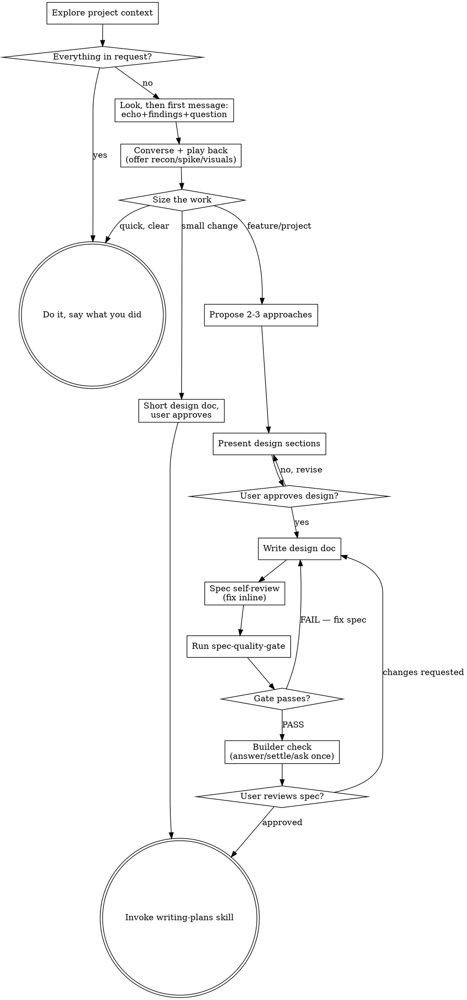

# Brainstorming Process Flow

Moved verbatim from `SKILL.md` (private-ai-harness 5.0.0) to keep the skill
under the 20,000-byte limit Claude Code applies when it re-attaches skills
after compaction. Read it at the step that points here.

