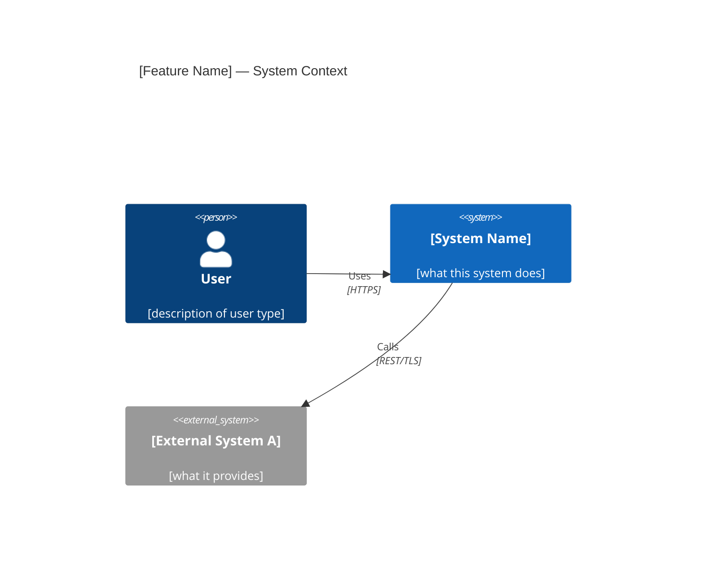
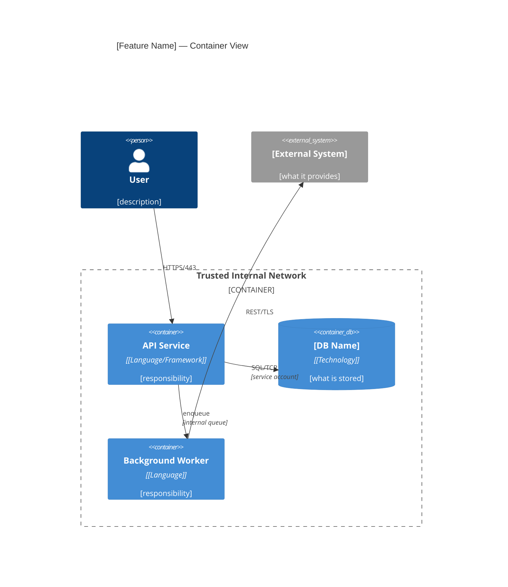

# HLD Document Template

Moved verbatim from `SKILL.md` (private-ai-harness 5.0.0) to keep the skill
under the 20,000-byte limit Claude Code applies when it re-attaches skills
after compaction. Read it at the step that points here.

## HLD Document Format

Save to: `.ai/YYYY-MM-DD-<feature-slug>/hld/hld-<feature-slug>.md`

````markdown
# [Feature Name] — High Level Design

**Date:** YYYY-MM-DD
**Spec:** `.ai/YYYY-MM-DD-<feature-slug>/specs/specs-<feature-slug>.md`
**Status:** Draft | Under Review | Approved
**Reviewers:** [names]
**Approved by:** [name] on [date]

---

## 1. Context and Scope

[Why this system is being built. What problem it solves. Where it sits in the broader ecosystem. 2–3 paragraphs. Objective facts only — no opinions, no rationale. Per Google Design Doc: "rough overview of the landscape in which the new system is being built."]

---

## 2. Goals and Non-Goals

**Goals:**
- [What this design achieves — specific and measurable where possible]

**Non-Goals:**
- [What this design explicitly does NOT address — state what could be assumed but isn't in scope]

*Non-goals are as important as goals. They prevent scope creep and misaligned review feedback.*

---

## 3. System Diagrams (C4 Model)

### 3.1 Context — C4 Level 1

> Actors and systems that interact with the system being designed.



### 3.2 Containers — C4 Level 2

> Internal runtime components: services, databases, queues, and their relationships. Trust boundaries annotated here.



| Container | Technology | Responsibility |
|-----------|------------|---------------|
| API Service | [Language + Framework] | [one sentence] |
| [DB Name] | [Technology + version] | [one sentence] |

---

## 4. Technology Selection

*Per Stripe's API design practice: every non-obvious choice is documented with why alternatives were rejected.*

| Component | Technology | Rationale | Alternatives Considered |
|-----------|------------|-----------|------------------------|
| Web framework | [name + version] | [specific property that made it the choice] | [alternative]: [specific rejection reason] |
| Primary datastore | [name + version] | [specific property] | [alternative]: [specific rejection reason] |
| Message queue | [name + version] | [specific property] | [alternative]: [specific rejection reason] |
| Auth | [mechanism] | [specific property] | [alternative]: [specific rejection reason] |

*If an alternative was not seriously considered, omit that row — do not invent alternatives for appearance.*

---

## 5. The Actual Design

*Per Google Design Doc: "emphasis on trade-offs." Not implementation detail — the shape of the solution and why.*

### 5.1 API Surface

[Key endpoints — method, path, purpose. Not a full OpenAPI spec — that belongs in `api-contract-first`. The shape that drives architectural constraints: sync vs async, request payload size, response latency budget.]

### 5.2 Data Model

[Entities, relationships, key constraints. Not a full schema — the conceptual model that determines storage selection and query patterns.]

### 5.3 Key Flows

[For any operation touching 3+ components, describe the sequence: who calls whom, in what order, what data crosses the boundary, what happens on failure at each step.]

---

## 6. Security Architecture

*Based on AWS threat modeling: Shostack 4-Question Frame + STRIDE per component.*

### 6.1 What Are We Working On?
[Data classification: what sensitive data does this system handle? PII / PCI / internal / public. Where does it flow?]

### 6.2 Threat Model (STRIDE)

| Threat | Component | Risk | Mitigation |
|--------|-----------|------|-----------|
| **S**poofing | [API Service] | [Can callers impersonate others?] | [JWT RS256 with issuer validation] |
| **T**ampering | [DB] | [Can data be modified in transit?] | [TLS 1.3 in transit, integrity constraint at DB] |
| **R**epudiation | [API Service] | [Can actions be denied?] | [Audit log with immutable append-only store] |
| **I**nformation Disclosure | [Worker] | [Can data leak to unauthorized callers?] | [Secret manager, no secrets in env output] |
| **D**enial of Service | [API Service] | [Can service be overwhelmed?] | [Rate limiting at edge, connection pool cap] |
| **E**levation of Privilege | [Auth layer] | [Can low-privilege user gain higher access?] | [RBAC with explicit allow-list, no wildcard grants] |

### 6.3 Security Controls

| Concern | Decision | Rationale |
|---------|----------|-----------|
| Authentication | [JWT RS256 / OAuth2 / API key / mTLS] | [specific reason] |
| Authorization | [RBAC / ABAC / capability-based] | [specific reason] |
| Encryption at rest | [AES-256 via managed key / field-level / none + justification] | [specific reason] |
| Encryption in transit | [TLS 1.3 minimum] | [standard] |
| Secret management | [vault / KMS / env vars via CI secret store] | [specific reason] |
| Data classification | [PII fields: list them / no PII] | [regulatory driver if any] |

**Trust boundaries:** Annotated on C4 Container diagram above (dashed line = trust boundary crossing).

### 6.4 Did We Do a Good Job? (Verification)
- [ ] All STRIDE threats have documented mitigations
- [ ] All PII fields identified and encrypted at rest
- [ ] No secrets in code, config files, or logs
- [ ] Auth enforced at every external-facing entry point
- [ ] Least-privilege service accounts for all components

---

## 7. Failure Mode Analysis

*Per AWS Well-Architected Reliability pillar: design for failure, not around it.*

| Component | Failure Mode | User Impact | Mitigation | Recovery Target |
|-----------|-------------|-------------|------------|-----------------|
| API Service | Process crash | All requests fail (5xx) | Health check + auto-restart (k8s/systemd) | < 30s |
| [DB] | Connection exhaustion | Writes fail | Connection pool (max N) + circuit breaker | < 5s |
| [Worker] | Job stuck | Delayed processing | Dead letter queue + alert after N retries | < 5 min |
| [External System] | Unavailable | Dependent feature fails | Circuit breaker + graceful degradation fallback | < 1 min |

---

## 8. Capacity Planning

*Based on NFRs from spec. Three scenarios per AWS/SRE practice. Scaling triggers at 70%/80% utilization.*

| Metric | Source | Pessimistic | Expected | Optimistic |
|--------|--------|-------------|----------|------------|
| RPS (sustained) | NFR | [0.5× target] | [target] | [2× target] |
| RPS (peak) | NFR | [1.5× expected] | [2× expected] | [3× expected] |
| DB rows / data volume | estimate | [low] | [mid] | [high] |
| p99 latency budget | NFR | [target] | [target] | [target] |
| Concurrent connections | derived | [low] | [mid] | [high] |

**Scaling triggers:**
- 70% capacity: begin preparation (provision lead time)
- 80% capacity: initiate scaling action
- 85% sustained: never exceed in production

**Scaling strategy per dimension:**
| Metric | Trigger | Action |
|--------|---------|--------|
| CPU (API pods) | > 70% avg 5 min | Horizontal pod autoscaling |
| DB connections | > 80% pool | Increase pool / add read replica |
| Storage | > 70% | Pre-provision + alert |

---

## 9. Cross-Cutting Concerns & Quality-Attribute Scenarios

*AWS Well-Architected 6 Pillars — address each explicitly or state "not
applicable + reason." For each applicable pillar, give a **measurable
quality-attribute scenario** (ATAM), not a vibe: a concrete stimulus →
measurable response, so the architecture is verifiable against it.*

| Pillar | Addressed? | Quality-attribute scenario (stimulus → measurable response) |
|--------|-----------|-------------|
| Operational Excellence | [Yes/Partial/No] | [e.g. "an alert fires → on-call has a runbook that resolves it in < 15 min"] |
| Security | [Yes] | [See §6 — STRIDE mitigations] |
| Reliability | [Yes] | [e.g. "one AZ fails → service stays up, error rate < 0.1%" — see §7] |
| Performance Efficiency | [Yes/Partial/No] | [e.g. "p99 read latency < 200ms at 10× current load"] |
| Cost Optimization | [Yes/Partial/No] | [estimated monthly infra cost at expected load] |
| Sustainability | [Yes/Partial/No] | [any energy / carbon considerations] |

**Sensitivity & tradeoff points (ATAM):** name the decisions that strongly move
one attribute (sensitivity points) and the ones where improving one attribute
hurts another (tradeoff points) — e.g. "synchronous replication buys durability
but costs write latency." These are what the ADRs must justify.

**Stakeholder concern → view traceability (ISO/IEC/IEEE 42010):** confirm each
stakeholder concern (from §1) is answered by at least one view — the C4 Context
view for scope concerns, the Container view for deployment/interaction concerns,
§5 for data/flow concerns, §6 for security concerns. A concern no view addresses
is a hole in the design, not just the document.

---

## 10. Alternatives Considered

*Per Google Design Doc: "describe viable alternatives and the reasons for picking the proposed design over them."*

| Alternative | Why Rejected |
|-------------|-------------|
| [Approach B] | [Specific property it lacks that the chosen design has — not "worse" in general] |
| [Approach C] | [Specific trade-off that makes it unsuitable for this context] |

---

## 11. Open Questions

*Unresolved design decisions. All must be resolved or explicitly deferred before `writing-plans` activates.*

| Question | Owner | Decision Deadline | Impact if Unresolved |
|----------|-------|-------------------|---------------------|
| [specific question] | [name] | YYYY-MM-DD | [what gets blocked or decided incorrectly] |

---

## 12. Architecture Decision Records

| ADR | Decision | Status |
|-----|----------|--------|
| [ADR-NNN-title.md](../wiki/architecture/ADR-NNN-title.md) | [one-line decision] | Accepted |
````
